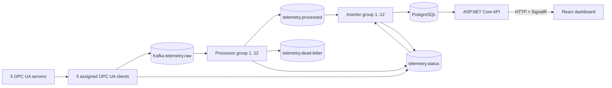

# Industrial Energy Telemetry Platform

IETP is an open-source .NET 10 and React platform that moves real OPC UA subscription data through Kafka, validates it in horizontally scalable consumer groups, persists it idempotently in PostgreSQL, and exposes live and historical operations data through ASP.NET Core, SignalR, and an industrial monitoring dashboard.

The project is a portfolio-grade reference for industrial software, power systems, and energy-data engineering. Running services use real OPC UA, Kafka, and PostgreSQL integrations; mocks are limited to isolated tests.

## Architecture



[ADR 0001](docs/architecture/0001-platform-foundation.md) contains the responsibility matrix, data model, identity rules, and delivery guarantees.

## Stack

- .NET 10, ASP.NET Core, Worker Services
- Official OPC Foundation UA .NET libraries
- Confluent.Kafka and Apache Kafka/KRaft
- PostgreSQL 18 and Npgsql
- React 19, TypeScript, Vite, Material UI, TanStack Query, Recharts, SignalR
- OpenTelemetry Collector, Prometheus, Grafana, Jaeger
- Docker Compose, Helm/Kubernetes, KEDA
- xUnit and Testcontainers

## Industrial simulation

One configurable executable supplies five independently deployed servers:

| Server | Asset | Measurements |
|---|---|---|
| Wind farm | Turbine | wind/rotor speed, power, temperature, status, cumulative energy |
| Solar farm | Inverter | irradiance, temperature, DC voltage/current, power, status |
| Power grid | Feeder | frequency, voltage/current, active/reactive power, power factor, connection |
| Battery | BESS | state of charge, bidirectional power, voltage/current, temperature, mode |
| Plant | Motor | speed, vibration, temperature, energy, load, state |

Seeds, update interval, anomalies, and failure windows are configurable. Solar output follows irradiance and temperature; battery state of charge integrates power; grid power follows voltage, current, and power factor.

OPC UA is used because it preserves typed industrial address spaces, quality/status codes, source timestamps, subscriptions, certificates, and interoperable security policies.

## Delivery and identity

Clients retain typed values, quality, OPC UA status, and source/server/receive timestamps. Idempotent producers key JSON events by stable series UUID. Processors publish processed or dead-letter records before committing raw offsets. Inserters commit processed offsets only after their PostgreSQL transaction succeeds.

Delivery is at least once. A processor crash after publication and before offset commit can duplicate output; the unchanged event ID is claimed in the non-partitioned `telemetry_event_receipts` table before the partitioned measurement insert, making replay harmless.

Canonical keys use `{country}.{environment}.{site}.{asset}.{measurement}`:

```text
dk.demo.windfarm01.turbine01.active_power
dk.demo.solarfarm01.inverter01.dc_voltage
dk.demo.grid01.feeder01.grid_frequency
dk.demo.battery01.bess01.state_of_charge
dk.demo.plant01.motor01.machine_vibration
```

A fixed UUID-v5 namespace maps each key to the same UUID across services and restarts. The idempotent registry also stores site, asset, unit, type, server, namespace URI, NodeId, description, tags, creation time, and active state.

```text
nsu=urn:ietp:dk:demo:windfarm01;s=asset/turbine01/active_power
→ readable series key → stable UUID/Kafka key
→ PostgreSQL receipt + measurement
→ API history → labelled kW chart
```

## Kafka topics

| Topic | Partitions | Purpose |
|---|---:|---|
| `telemetry.raw` | 12 | source notifications and replay |
| `telemetry.processed` | 12 | validated/enriched telemetry |
| `telemetry.dead-letter` | 6 | invalid payload plus diagnostics |
| `telemetry.status` | 6 | operational heartbeat evidence |

Ordering is retained per series. More consumer replicas than partitions do not add parallelism.

## PostgreSQL lifecycle

Embedded migrations are serialized with a PostgreSQL advisory lock and recorded in `schema_migrations`. Storage includes sites, assets, servers/clients, series definitions, partitioned measurements, global event receipts, service instances, and heartbeats.

Retention defaults to 30 days in `platform_settings`. Schedule `SELECT purge_expired_telemetry();` during maintenance. Large installations should create monthly partitions ahead of time and drop expired partitions instead of deleting rows.

## Local execution

With Docker Compose and at least 8 GB available RAM:

```bash
docker compose up --build
```

- Dashboard: <http://localhost:3000>
- API/OpenAPI: <http://localhost:8080/openapi/v1.json>
- Liveness/readiness: `/health/live`, `/health/ready`

Compose explicitly enables unsecured OPC UA only under `DOTNET_ENVIRONMENT=Development`. Application defaults require `Basic256Sha256`, signing/encryption, explicit trust, SHA-1 rejection, and 2048-bit keys. Production must provision and mount certificates/trust lists.

Optional engineering observability:

```bash
docker compose --profile observability up --build
```

Grafana is on port 3001, Jaeger on 16686, and Prometheus on 9090. The React UI presents operator/domain state; Grafana and Jaeger present engineering metrics and traces.

## Dashboard

- Overview health, active replicas, throughput, latest timestamp, quality/dead-letter counts
- OPC UA endpoints, evidence-based status, communication time, subscriptions/items, retries/errors
- Service uptime, heartbeat, counters, errors, and latency
- Searchable series metadata and NodeId mappings
- Compatible-unit comparison for up to four numeric series
- Discrete state history, live SignalR refresh, dark/light responsive layout

## Kubernetes

The Helm chart under `infrastructure/kubernetes/ietp` generates all five server/client pairs and independently scales processors/inserters. KEDA uses consumer lag and caps each group at the 12-partition concurrency limit. See [deployment guidance](docs/deployment/kubernetes.md).

## Testing

```bash
dotnet restore IndustrialEnergyTelemetry.slnx
dotnet build IndustrialEnergyTelemetry.slnx --no-restore
dotnet test IndustrialEnergyTelemetry.slnx --no-build --filter "Category!=EndToEnd"

cd frontend
npm ci
npm run typecheck
npm run build
npm run lint
```

The Testcontainers integration tests require a working Docker-compatible daemon. After Compose is healthy, run:

```bash
IETP_BASE_URL=http://localhost:3000 dotnet test tests/Telemetry.EndToEndTests
```

Unit tests cover identity, validation, and correlated simulation. Testcontainers integration tests use real Kafka and PostgreSQL. The E2E test requires all five sources to become persisted/queryable and verifies API/frontend visibility. See [implementation status](IMPLEMENTATION_STATUS.md) for what has actually been verified in this workspace.

See [failure scenarios](docs/failure-scenarios/compose.md) for disconnect/reconnect, consumer replacement, database outage/recovery, replay/deduplication, invalid-message dead lettering, and deterministic simulation failure.

## Security and limitations

- No real secrets are committed; deployments supply database credentials.
- The Kubernetes Secret is a template and must be replaced by secret management.
- Enable Kafka/PostgreSQL authentication and transport encryption in production.
- The demonstration API has no end-user authentication and must not be internet-exposed as-is.
- Compose Kafka/PostgreSQL are single-node development infrastructure.
- Client HA ownership leases and a SignalR scale-out backplane are documented future work.
- Consumer lag is used by KEDA but is not yet surfaced in the API/dashboard; some requested infrastructure detail and chart interactions remain outstanding.
- The default telemetry partition is suitable for development; automate monthly partitions in production.

## License

[MIT](LICENSE)
