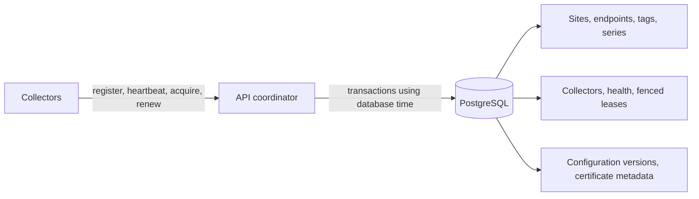

# Control plane

The control plane owns configuration and endpoint ownership; it never handles measurement values. PostgreSQL is authoritative so multiple API/coordinator replicas cannot issue conflicting leases from local state.

`003_control_plane.sql` adds endpoint security/configuration fields, operational tag settings, collector registration and health, certificate metadata, configuration versions, and exclusive assignments. Private keys are deliberately absent; `identity_reference` and `trust_reference` point to protected stores.

The existing `opcua_servers` IDs remain stable endpoint IDs. Existing `series_definitions` remain the series/tag authority during migration, preserving UUIDs and historical foreign keys. The in-code catalog still bootstraps the five demonstrations, now including endpoint-to-site and application-URI metadata.

## Coordinator API

- `POST /api/control-plane/collectors` registers or restarts an instance.
- `PUT /api/control-plane/collectors/{id}/health` reports capacity use and edge-buffer health.
- `POST /api/control-plane/collectors/{id}/assignments?leaseSeconds=30` fills available capacity with eligible site-local endpoints.
- `PUT /api/control-plane/collectors/{id}/assignments/{endpointId}` renews an exact epoch.
- `DELETE /api/control-plane/collectors/{id}` marks it draining and expires its leases.
- `GET /api/control-plane/collectors` and `/assignments` provide operator views.
- `GET /api/control-plane/configuration-versions` and `/certificates` expose configuration history and certificate expiry state.

Mutation endpoints are collector-facing infrastructure endpoints. Production ingress must restrict them to authenticated collector identities; application authentication is a remaining deployment requirement.
