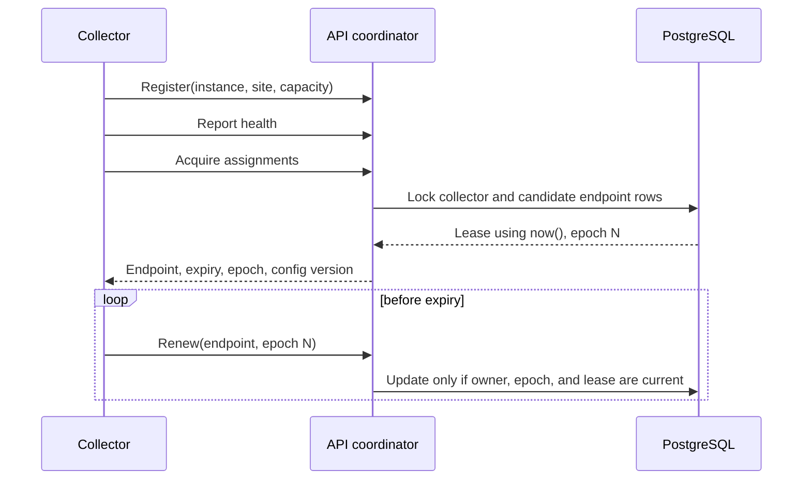

# Coordinator and fenced leases

Logical ownership is separate from the physical OPC UA session. A lease authorizes one collector to start or continue acquisition for an endpoint; an abandoned server-side session may remain until its negotiated timeout, but it no longer has valid logical ownership.



`collector_assignments.endpoint_id` is the primary key, preventing duplicate active assignment rows. Candidate endpoint rows are locked with `FOR UPDATE ... SKIP LOCKED`, so coordinator replicas can assign concurrently without conflicting. PostgreSQL `now()` makes expiry independent of collector/API clock skew. Reassignment increments `lease_epoch`; re-acquisition by the same owner retains it. Expired leases cannot be renewed, and graceful shutdown expires rather than deletes rows so epochs remain monotonic.

```mermaid
sequenceDiagram
  participant Old as Collector A
  participant DB as PostgreSQL
  participant New as Collector B
  Old--xDB: Heartbeats stop
  Note over DB: Lease expires
  New->>DB: Acquire endpoint
  DB-->>New: epoch N+1
  Old->>DB: Renew epoch N
  DB-->>Old: rejected
  Note over Old: Stop new acquisition; close session when reachable
```

This phase fences control-plane ownership. Telemetry contract epochs and trusted ingestion-boundary enforcement are the next required step. Durable records accepted before expiry must use an explicit replay policy rather than being discarded solely because their live epoch is old.
